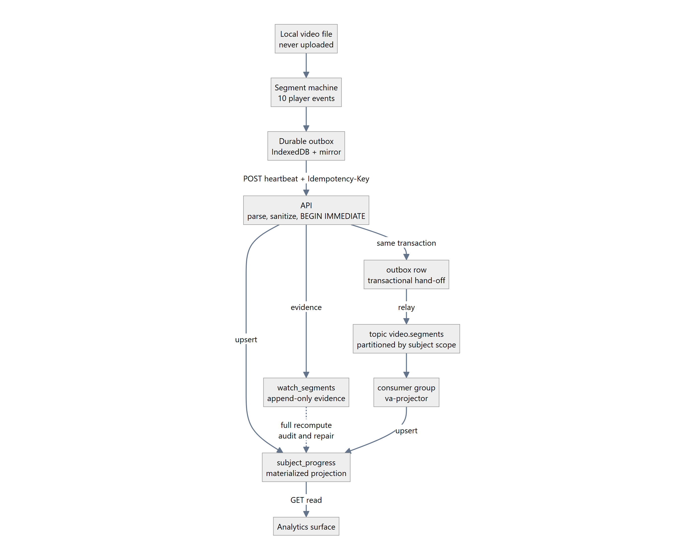
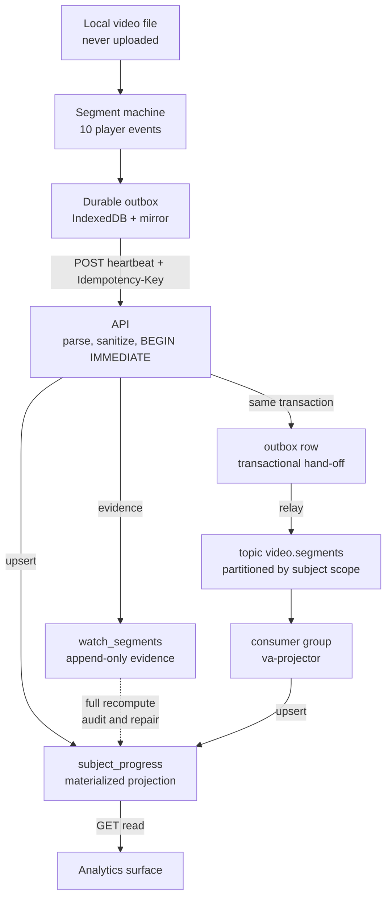
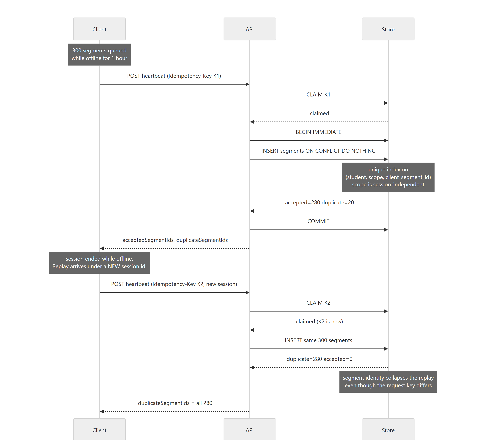
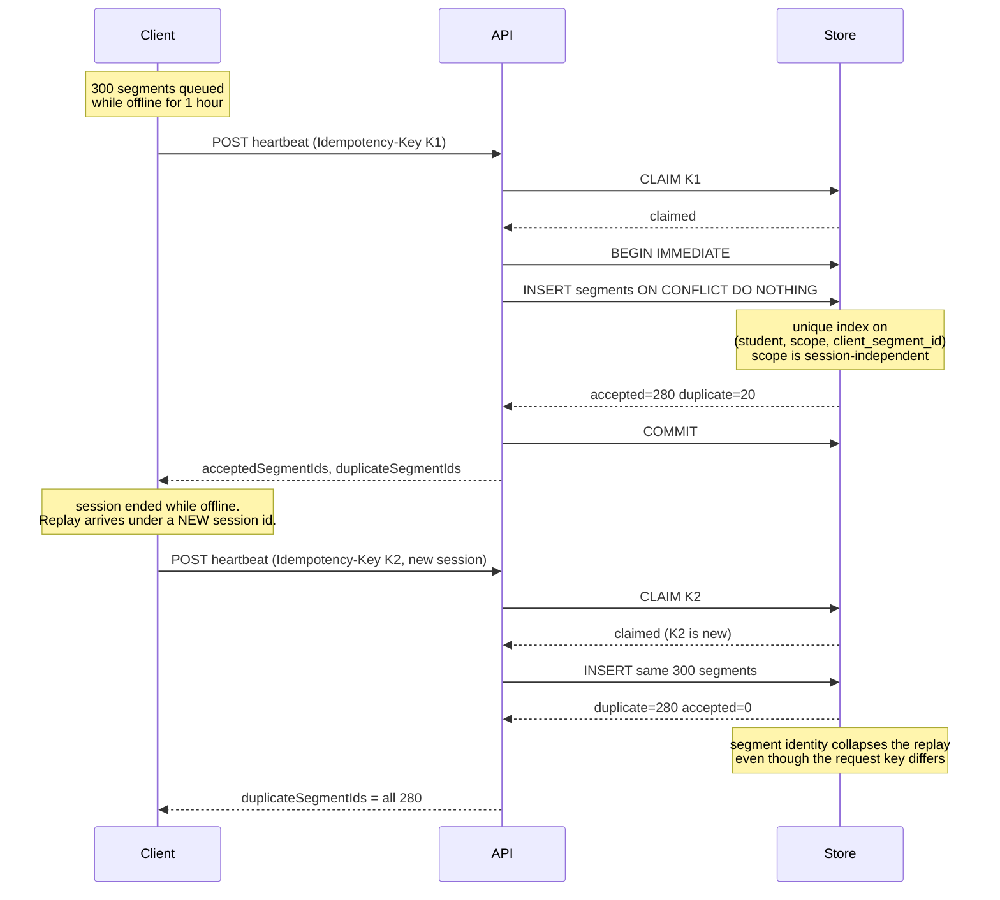
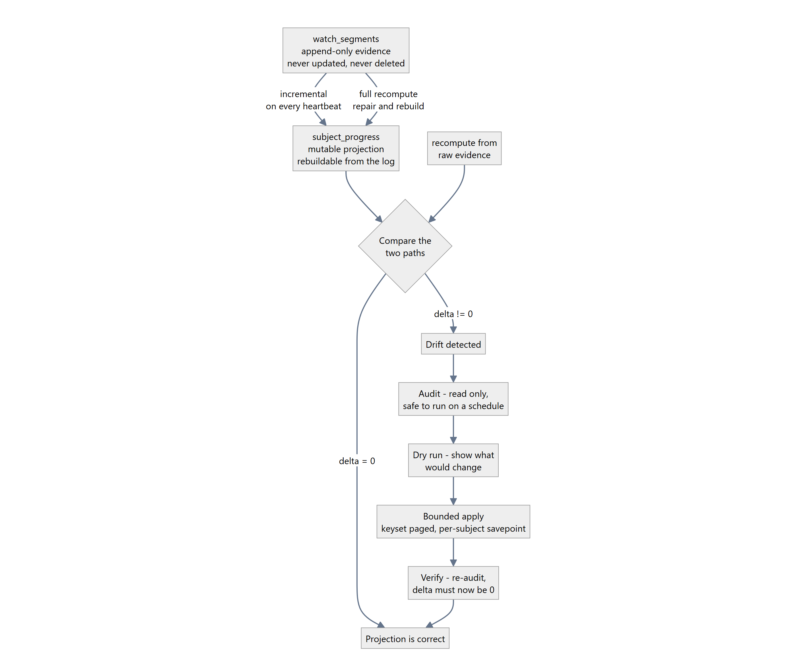
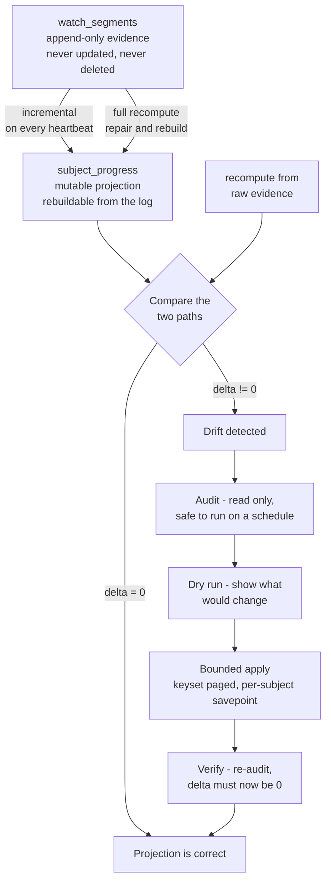
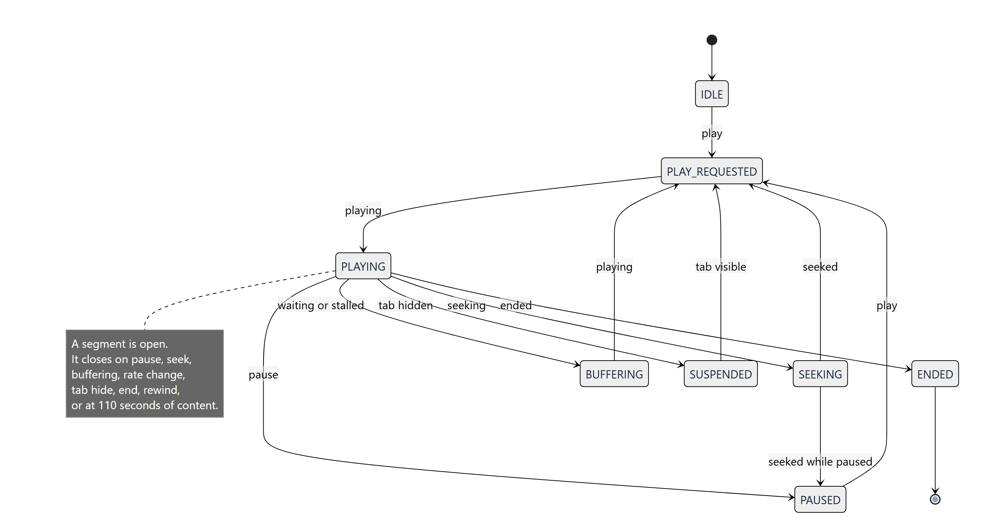
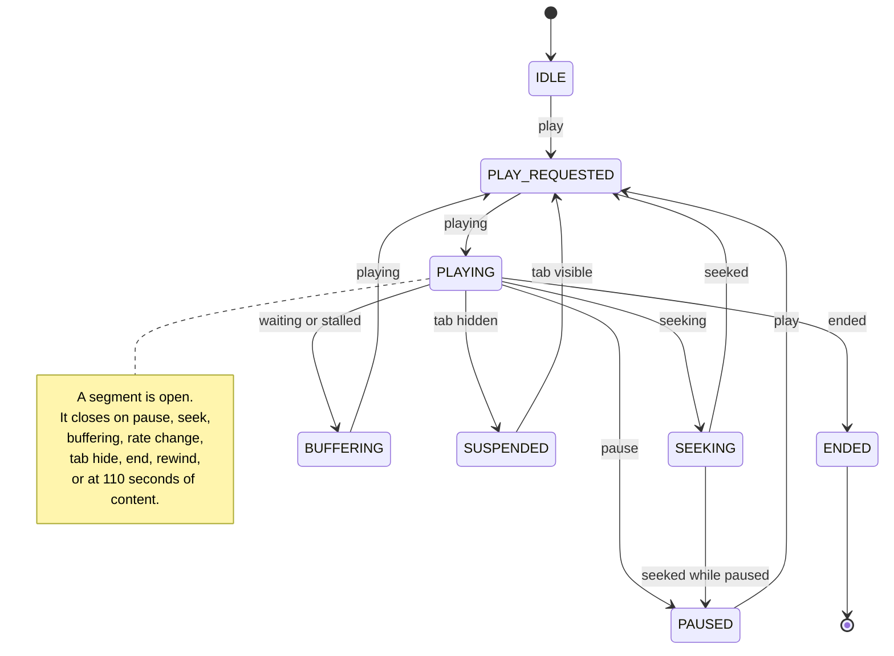

# Video Analytics Engine

**A backend-heavy telemetry ingest engine for video watch-time.**

This is a **general watch analytics engine**. It has no player integration, no
player-provider SDK, and no playback-token layer. It ingests evidence from any source that
can emit standard media events, and it never fetches media, catalog data, or provider
metadata. Playback stays outside the boundary on purpose: the engine only decides what the
events it receives are worth.

The client is untrusted, so watched seconds are never taken from the client's word — they
are recomputed server-side from the intervals the client claims, against a policy the
client cannot influence. Delivery is at-least-once, so ingest is idempotent at two
independent levels. Reads are served from a materialized projection over an append-only
evidence log, and because a projection can drift, the drift is measurable, repairable in
bounded resumable pages, and verifiable afterwards.

---

## Table of contents

- [1 · Why this is not a counter](#1--why-this-is-not-a-counter)
- [2 · The four invariants](#2--the-four-invariants)
- [3 · System architecture](#3--system-architecture)
- [4 · The watch math](#4--the-watch-math)
- [5 · Two layers of idempotency](#5--two-layers-of-idempotency)
- [6 · Evidence, projection, and the repair engine](#6--evidence-projection-and-the-repair-engine)
- [7 · The client](#7--the-client)
- [8 · Broker and projector](#8--broker-and-projector)
- [9 · Failure matrix](#9--failure-matrix)
- [10 · Project layout](#10--project-layout)
- [11 · Running it](#11--running-it)
- [12 · API reference](#12--api-reference)
- [13 · Verifying it](#13--verifying-it)
- [14 · What must not regress](#14--what-must-not-regress)

---

## 1 · Why this is not a counter

Watch-time analytics looks like a counter and behaves like a distributed systems
problem. Three properties are true at once, and each one alone is a bug:

| Property | What it means | What breaks without handling it |
|---|---|---|
| **The client is untrusted** | The client controls the browser. It can claim it watched 60 seconds while spending 6. | Any metric derived from a client-supplied scalar is a suggestion, not a measurement. |
| **Delivery is at-least-once** | Learners go offline, tabs close, proxies retry, `sendBeacon` delivers twice. The same evidence arrives more than once — sometimes under a *different session id*. | Watch time inflates. A learner who resumes a video on Tuesday gets credited for Monday's viewing again. |
| **Projections drift** | Any cached aggregate over an append-only log eventually disagrees with the log. Code that was right for every case that happened is not right for the case that has not happened yet. | The number is wrong and nothing says so. |

### The failure this produces in a naive implementation

The natural projection is *add the new segment's length to the stored total*. That is
wrong the moment a learner rewatches anything, because the stored `unique` figure has to
be the size of the **union** of all ranges — and a union cannot be updated by addition.

```ts
// ✗ Anti-pattern — a union cannot be updated by addition.
progress.uniqueContentSeconds += segment.endSecond - segment.startSecond;

// ✗ Anti-pattern — summing per-session unique totals double-counts a rewatch.
const total = sessions.reduce((sum, s) => sum + s.uniqueWatchedSeconds, 0);

// ✓ Correct — union the stored ranges with the new ones, then re-measure.
const merged = mergeRanges([...progress.watchedRanges, newRange]);
progress.uniqueContentSeconds = sumRanges(merged);
```

This project exists to make the correct version the only version.

---

## 2 · The four invariants

Everything in this codebase is an implementation of these four rules. If a change breaks
one of them, the number the product shows is no longer defensible — regardless of whether
it looks right.

| # | Invariant | Enforced by | Proven by |
|---|---|---|---|
| **1** | **The client is untrusted.** Watched seconds are always recomputed server-side from raw segment ranges. | The API never reads a client-supplied total. `computeWatchMetrics` is the only producer of a number. | Assert the server's summary is derived from segment rows, not from the payload scalars. |
| **2** | **Delivery is at-least-once.** Ingest is idempotent at the request level *and* at the segment level. | `UNIQUE(idempotency_key)` and `UNIQUE(student, scope, client_segment_id)`. | Replay a full outbox under a new session id; assert totals are unchanged. |
| **3** | **Reads are projections.** An append-only evidence log is the truth; the projection is a cache. | `watch_segments` is never updated or deleted. `subject_progress` is derived. | Drop the projection and rebuild it from the log; the numbers must match. |
| **4** | **A projection can drift, so drift is detectable, repairable in pages, and verifiable.** | `audit → dry-run → bounded apply → verify`, all in one framework-free engine. | Inject drift, repair it, re-audit; the delta must be zero. |

### The trust boundary

There is no credential in this engine. The client sends evidence, and the server decides
what the evidence is worth using arithmetic it controls: segment bounds, playback-rate
limits, wall-clock plausibility, batch budgets, and a union of ranges. Identity fields
(`studentId`, `subjectType`, `subjectId`, `assetId`) are dimensions of the evidence, not
permission claims. A gateway or product layer can add authentication and authorization in
front of these routes without changing the measurement path.

That separation is deliberate. Access control answers *who may watch what*; this engine
answers *what was watched*. Coupling the two would make the analytics depend on a player
provider, a token format, or an entitlement system — none of which belong in the number.

---

## 3 · System architecture



<details>
<summary>Diagram source (mermaid)</summary>



</details>

Three paths, and they are deliberately separate:

- **The write path** is synchronous and transactional. One `BEGIN IMMEDIATE` covers the
  evidence insert, the session update, the projection upsert and the outbox row. If any
  part fails, none of it happened — which is what makes the client's retry safe.
- **The read path** never touches raw evidence. It reads the projection.
- **The repair path** is the only thing allowed to rewrite derived state, and it does so
  in bounded, resumable pages.

> **The broker never decides whether a segment counts.** That is enforced by a unique
> index in the store. The broker only decides *when* the projection updates — which is
> why the system behaves identically with an in-process broker and with Apache Kafka.

---

## 4 · The watch math

The client sends **evidence** — intervals plus the wall-clock time it claims to have
spent on them. It never sends a "watched seconds" number. This is where evidence becomes
a number, and it is the only place that happens.

| Quantity | Definition | Rewatch counted | Paused time |
|---|---|---|---|
| `totalWatched` | Plain sum of every segment's length | Yes — twice | Excluded |
| `uniqueWatched` | Length of the **union** of all ranges, clipped to duration | No — once | Excluded |
| `repeatWatched` | `totalWatched − uniqueWatched` | Is the rewatch | Excluded |
| `engagedWallClock` | Σ per-segment wall-clock evidence | Yes — it is real time | Excluded by construction |

```ts
/**
 * Compute the four watch metrics from raw segment evidence.
 *
 * `videoDurationSeconds` is the *authoritative* duration, resolved server-side.
 * When it is unknown the raw union is preserved rather than zeroed, because
 * "we do not know how long the video is" and "they watched nothing" are
 * different facts and collapsing them loses data.
 */
export function computeWatchMetrics(
  ranges: RawWatchRange[],
  videoDurationSeconds: number,
): WatchMetrics {
  let total = 0;
  let wallClock = 0;
  const validRanges: Range[] = [];

  for (const row of ranges ?? []) {
    const start = Number(row?.start ?? 0);
    const end = Number(row?.end ?? 0);
    if (!Number.isFinite(start) || !Number.isFinite(end) || end <= start) continue;
    validRanges.push({ start, end });
    total += end - start;
    wallClock += Math.max(0, Number(row.wallClockSeconds ?? 0));
  }

  const uniqueRaw = sumRanges(mergeRanges(validRanges));
  const duration = Number(videoDurationSeconds);
  const unique =
    Number.isFinite(duration) && duration > 0 ? Math.min(uniqueRaw, duration) : uniqueRaw;

  return {
    uniqueWatched:  Number(Math.max(0, unique).toFixed(2)),
    totalWatched:   Number(Math.max(0, total).toFixed(2)),
    repeatWatched:  Number(Math.max(0, total - unique).toFixed(2)),
    engagedWallClock: Number(Math.max(0, wallClock).toFixed(2)),
  };
}
```

**Why paused time is excluded.** A segment is a contiguous stretch of playback. Pausing
closes the segment, so no segment spans the pause. The exclusion is not a filter applied
afterwards — it falls out of the data model.

**Why two "watch time" numbers exist.** `engagedWallClockSeconds` is real time spent
with playback running. `uniqueContentSeconds` is how much of the video's *content* was
seen, once. A video watched at 2× for 30 minutes covers 60 minutes of content but is 30
minutes of study. Reporting one under the label of the other is how "learned 40 hours
this week" ends up meaning something other than what the learner did.

---

## 5 · Two layers of idempotency

Not one mechanism — **two**, solving two different problems. A single layer is never
enough.



<details>
<summary>Diagram source (mermaid)</summary>



</details>

| Property | Layer 1 — request key | Layer 2 — segment identity |
|---|---|---|
| Question it answers | Was this exact HTTP request already applied? | Have I already counted this piece of evidence? |
| Enforced by | `UNIQUE(idempotency_key)` | `UNIQUE(student, scope, client_segment_id)` |
| Lifetime | 60 seconds | Forever — the evidence is permanent |
| Survives a new session id | **No** | **Yes** |
| Claim ordering | After the request parses, before the write | Inside the write transaction |

### The two decisions that are easy to get wrong

**The scope key is session-independent on purpose.** The client that was offline long
enough for its session to expire replays its segments under a *new* session id. If the
dedup identity included the session, the replay would be counted twice — the exact
failure the layer exists to prevent.

```sql
-- The scope is a generated column, so application code cannot get it wrong.
scope TEXT NOT NULL   -- subject_type || ':' || COALESCE(subject_id, 'unknown')
```

**The claim is taken after the request parses, never before the write.** If the claim were
taken before parsing, a malformed request would consume the key, and the client's corrected
retry would be answered with "already applied" — a cheerful success for a request that
never happened. The client would drop the evidence, and the watch time would be lost with
no error anywhere.

> **A duplicate is marked, never deleted.** It is preserved for audit and excluded from
> every calculation by a flag. Deleting evidence destroys the ability to explain why a
> number is what it is.

---

## 6 · Evidence, projection, and the repair engine



<details>
<summary>Diagram source (mermaid)</summary>



</details>

### The two paths must agree

The incremental path (fold each new batch into the stored projection) and the
authoritative path (recompute from every raw segment) have to produce identical numbers.
This is not a hope — it is asserted by the test suite, and the repair engine compares
the two on demand.

The equivalence holds for a reason worth stating: `total` and `engaged` are plain sums, so
adding is correct; but `unique` is the length of a union, so it is maintained by unioning
the *stored ranges* with the *new ranges* and re-measuring — never by adding lengths.

### Why the repair is paged

A repair that locks a million rows for an hour is not a repair, it is an outage. The
engine walks `(student, subject_type, subject_id)` in ascending keyset order, holds at
most one page of locks at a time, and returns a cursor so an interrupted run resumes
exactly where it stopped. Each subject is repaired inside its own savepoint, so one bad
row is reported and skipped rather than aborting the batch.

```ts
// Keyset pagination. The cursor is the last subject of the previous page.
const last = subjects[subjects.length - 1];
result.nextCursor = last ? subjectKey(last) : null;
```

### The strongest check available

Drop the projection and rebuild it from the log. If the numbers match what the
incremental path produced, that path is correct. If they do not, that path has a bug —
and this is the operation that finds it.

---

## 7 · The client

The tracker is **player-agnostic**. It consumes ten standard media callbacks — `play`,
`playing`, `timeupdate`, `pause`, `seeking`, `seeked`, `ratechange`, `ended`, `waiting`,
`stalled` — which is exactly the set a native `<video>` element emits. It imports no player
SDK, embeds no iframe, and fetches no provider data. Any source that can surface those
events can feed it; the engine does not know or care which player produced them.

The contract between player and tracker is those ten events, nothing more. A native
`<video>` element satisfies it directly; a custom or third-party player satisfies it by
re-emitting the same callbacks. That is the whole adapter surface, so there is no vendor to
pin and nothing to rewrite when the player changes.



<details>
<summary>Diagram source (mermaid)</summary>



</details>

### The two subtleties that carry most of the weight

**Seek detection without a seek event.** A seek the browser reports is easy. A seek the
browser *does not* report — a dropped frame, a slow network, a device stall — is not. The
fix is arithmetic: if the playhead moved further than wall-clock time could possibly
explain, it moved on its own, and the segment must close.

```ts
const wallDeltaSec = (now - lastTickWall) / 1000;
const maxAllowedDelta = Math.max(0.35, wallDeltaSec * playbackRate * 1.35);
const isUnreportedJump = Math.abs(delta) > maxAllowedDelta;

if (isUnreportedJump) {
  closeActiveSegment();   // continuity is broken
  transition("SEEKING");
}
```

The tolerance is 1.35 because a legitimate jump is faster than real time by exactly the
playback rate, and stutters add noise on top of that.

**Wall clock is measured per segment, not per tick.** A segment's wall clock is the real
time between the moment it opened and the moment it closed. Paused time is therefore
excluded by construction — there is no segment spanning the pause.

### The outbox is the record

Every closed segment is written to durable storage *before* any network call is
attempted. The network is a delivery mechanism; the outbox is the record.

- **IndexedDB** is primary — it survives a high volume of small writes without blocking
  the main thread, and it supports transactions.
- **localStorage** is a coalesced mirror (200 ms debounce) — writing it synchronously on
  every mutation is a visible stutter on a video player. It is flushed synchronously on
  `pagehide` and `beforeunload`, and it becomes the *only* store if IndexedDB is blocked.
- **Capacity is bounded** at 300 records and 7 days. When the cap is hit the *oldest* are
  evicted first: the most recent watch time is the most relevant, and losing the oldest
  is the least damaging choice available.
- **The client never decides that a write landed.** The server's per-segment verdict
  (`accepted` / `duplicate` / `rejected`) is what removes a record from the outbox.

---

## 8 · Broker and projector

Making the projection a *consumer* rather than a side effect of a request handler is what
lets the read and write paths be deployed, tuned and failed independently.

| Semantic | How it is implemented | Why it matters |
|---|---|---|
| **partition** | The publisher hashes the event key to pick a partition | All events for one subject stay ordered |
| **offset** | Monotonic per partition; the consumer's progress marker | Makes replay and lag meaningful |
| **at-least-once** | A record is redelivered until the consumer commits past it | The consumer is idempotent, so this is safe |
| **consumer group** | Each partition is assigned to exactly one member | Two members never process one partition concurrently |
| **lag** | Committed offset vs. end offset, per partition | The number an alert fires on |
| **dead letter** | A repeatedly-failing record is moved aside | One poison message cannot stall the pipeline |
| **replay** | A group's committed offset can be rewound | Turns "rebuildable" from a claim into a demonstration |

Two implementations satisfy the same `Broker` interface:

- **`MemoryBroker`** (default) — in-process, zero infrastructure. Not a mock: it
  implements real partition assignment, monotonic offsets, consumer groups,
  at-least-once delivery, a dead-letter queue, lag accounting and offset replay.
- **`KafkaBroker`** (optional) — the same semantics over Apache Kafka via `kafkajs`.
  Enabled by setting `KAFKA_BROKERS`.

The demo never requires a broker to be installed, because the guarantee that actually
matters — *a segment is counted once* — is enforced by a unique index in the store, not
by the broker.

### The transactional outbox

The broker is not in the critical path of the write. The event is written to an `outbox`
table **in the same transaction as the evidence it describes**, and a relay publishes
unpublished rows. If the process dies between the commit and the publish, the row is
still there and the event goes out on the next pass.

> The row is marked published *after* the publish returns. If the process dies in
> between, the event is published **twice** rather than not at all — and publishing twice
> is safe, because the consumer is idempotent. The opposite ordering would lose events.

---

## 9 · Failure matrix

Every row is a state the system is designed to encounter, not a hypothetical.

| State | Detection | Response | Watch time |
|---|---|---|---|
| Client offline | Segments accumulate in the outbox | Flush refused; backoff; drain on reconnect | **Preserved** |
| Same request retried | Unique violation on the request key | Answered "already applied", no write | **Not double counted** |
| Replay under a new session | Unique violation on the segment identity | Segment marked duplicate, contributes zero | **Not double counted** |
| Session ended mid-offline | Server returns a terminal code | Client abandons the id, opens a new one, replays the outbox | **Preserved** |
| Client claims too much content | Plausibility bound on the segment | Rejected permanently with a reason code | **Not counted** |
| Batch too large | Cumulative request budget exceeded | Rejected as retryable; client splits and resends | **Preserved** |
| Write fails after the claim | Exception in the transaction | Claim released so a genuine retry is not suppressed | **Preserved** |
| Broker unavailable | Relay publish throws | Outbox row stays unpublished; retried next tick | **Preserved** |
| Projection drifts | Audit compares against a full recompute | Repair in bounded pages, then verify | **Corrected** |
| Abandoned sessions | Lifetime or inactivity window exceeded | Sweeper closes them server-side | **Preserved** |

### Rejection reasons, and the split that matters

| Reason | Retryable | Meaning |
|---|---|---|
| `invalid_bounds` | No | `endSecond` must be greater than `startSecond` |
| `segment_beyond_duration` | No | Beyond the authoritative duration |
| `max_segment_duration_exceeded` | No | A single segment cannot span more than 4 hours |
| `invalid_playback_rate` | No | Outside `[0.5, 4.0]` |
| `wall_clock_plausibility` | No | Content claims more time than the wall clock permits |
| `max_segments_exceeded` | No | Batch carried more than 50 segments |
| `request_watch_time_exceeded` | **Yes** | The batch, not the segment, was too big |
| `max_segment_limit_exceeded` | **Yes** | One segment is bigger than the request budget — split it |

A **permanent** rejection is dropped and the client is told to forget it. A **retryable**
rejection means the segment is fine and the *batch* was too big — the client splits and
resends. Getting this backwards is expensive in both directions: rejecting a legitimate
segment loses real watch time, and accepting an impossible one lets a client inflate its
own metrics.

---

## 10 · Project layout

```
video-eng/
├─ engine/                       ← framework-free core. Zero Next.js imports. 100% unit-testable.
│  ├─ watch-math.ts              The four metrics, union-of-ranges, coverage bitmap
│  ├─ policy.ts                  Every numeric bound, in one place
│  ├─ sanitize.ts                The twelve validation bounds; permanent vs retryable
│  ├─ segment-machine.ts         The client segment state machine
│  ├─ outbox.ts                  IndexedDB + coalesced localStorage mirror
│  ├─ idempotency.ts             Request claim, subject scope, dedup winner selection
│  ├─ projection.ts              Incremental apply, authoritative recompute, drift compare
│  ├─ reconcile.ts               Audit → dry-run → bounded apply → verify
│  └─ broker/
│     ├─ types.ts                The Broker interface
│     ├─ memory.ts               In-process broker with real Kafka semantics
│     └─ kafka.ts                Apache Kafka adapter (kafkajs)
│
├─ server/                       ← storage and orchestration
│  ├─ db.ts                      node:sqlite singleton, WAL, busy_timeout, transactions
│  ├─ schema.ts                  Idempotent DDL applied at boot — no migrations folder
│  ├─ repository.ts              Every storage operation, and the dedup insert
│  └─ broker.ts                  Broker selection + the outbox relay
│
├─ app/api/analytics/
│  ├─ session/route.ts           POST open · PUT finalize
│  ├─ heartbeat/route.ts         The hot path
│  ├─ read/route.ts              The analytics surface
│  └─ admin/route.ts             audit · repair · rebuild · broker stats · seek
│
├─ docs/diagrams/                     The generated diagram images used above
├─ scripts/render-diagrams.mjs        Diagram sources + the headless-Chrome renderer
├─ tests/                            Unit tests for the math, projection and repair engine
├─ next.config.ts                    Security headers and CSP, including media-src for local video
└─ README.md                         This document
```

> **`engine/` is a separate folder on purpose.** It has no framework imports and is fully
> unit-testable. That separation is what makes it read as *"a system I designed"* rather
> than *"route handlers I wrote"*.

---

## 11 · Running it

```bash
npm install
npm run dev
```

There is **no database to provision, no migrations to run, no Docker, no API keys and no
signup.** The SQLite file is created on first boot at `.data/analytics.db` from one
idempotent DDL script.

```bash
npm run db:reset     # delete .data/analytics.db and start clean
npm test             # vitest
node scripts/render-diagrams.mjs   # re-render the images in docs/diagrams
```

### How the diagrams are made

The four diagrams are generated from mermaid sources kept in
`scripts/render-diagrams.mjs` and rendered to `docs/diagrams/*.png` with headless Chrome.
Edit the source there and re-run the script; the images are rewritten in place.

### Why no migrations folder

A migration system exists to evolve a schema that already holds data across
deployments. This schema does not: the database file is created on first boot from
`server/schema.ts`, and the only evolution path that matters — "add a column" — is
covered by `ALTER TABLE … ADD COLUMN IF NOT EXISTS`. The trade is deliberate. A
migration ledger is real infrastructure with real failure modes: a half-applied
migration, a ledger that disagrees with reality, a new contributor who has to learn the
tool before they can run the app. For a schema this small, one idempotent script at boot
is strictly less machinery and cannot get out of sync.

### Enabling real Kafka

```bash
KAFKA_BROKERS=localhost:9092 npm run dev
```

`kafkajs` is an optional dependency and is imported lazily. With no broker configured the
in-process broker is used, and the demo path never touches Kafka at all.

---

## 12 · API reference

### `POST /api/analytics/session` — open a session

```jsonc
{
  "studentId": "student-1",
  "subjectType": "local_video",
  "subjectId": "clip-42",
  "assetId": "asset-42",
  "videoDurationSeconds": 600
}
```

Returns `{ ok, sessionId, alreadyOpen, progress, networkHeartbeatIntervalMs }`. Opening a
session twice returns the same session with `alreadyOpen: true` — the one-open-session
invariant is enforced by a partial unique index, because an application-level check
cannot survive two concurrent requests.

### `POST /api/analytics/heartbeat` — the hot path

Headers: `Idempotency-Key: <uuid>` (optional, but this is the request-level guard).

```jsonc
{
  "sessionId": "...",
  "currentTimeSeconds": 134.56,
  "eventType": "heartbeat",
  "segments": [
    {
      "startSecond": 12.34,
      "endSecond": 78.90,
      "playbackRate": 1.0,
      "source": "play",
      "clientSegmentId": "0f9c…",
      "playerInstanceId": "b3a1…",
      "clientSequence": 7,
      "wallClockSeconds": 66.56,
      "segmentStartedAt": "2026-10-22T09:12:03.114Z",
      "segmentEndedAt": "2026-10-22T09:13:09.674Z"
    }
  ],
  "counts": { "play": 1, "pause": 0, "seek": 0, "ratechange": 0 }
}
```

The session is the server-owned context. It fixes the student, subject, asset and
authoritative duration once, at open; the heartbeat carries evidence, not identity. That
is what keeps the measurement path independent of any player or provider.

Returns a **per-segment verdict**:

```jsonc
{
  "ok": true,
  "segmentsReceived": 3,
  "acceptedSegmentIds":  ["a", "b"],
  "duplicateSegmentIds": ["c"],
  "rejectedSegments": [
    { "clientSegmentId": "d", "reason": "wall_clock_plausibility", "retryable": false }
  ],
  "summary": {
    "videoDurationSeconds": 600,
    "totalWatchedSeconds": 300,
    "uniqueWatchedSeconds": 280,
    "repeatWatchedSeconds": 20,
    "engagedWallClockSeconds": 140,
    "completionPercentage": 46.67,
    "completed": false
  }
}
```

A replayed request returns `{ ok: true, deduplicated: true, duplicateSegmentIds: [...] }`
with no write. A terminal session error returns `404` for a session that does not exist and
`409` for a session that has already ended, with
`{ code: "SESSION_ENDED" | "SESSION_NOT_FOUND", sessionTerminal: true, retryable: false }`
— the signal the client uses to abandon a dead session id, open a new one, and replay
its outbox without losing watch time.

### `GET /api/analytics/read` — the analytics surface

`?studentId=…&subjectId=…` returns the projection, the canonical recompute, **and the
drift between them**. Surfacing the drift on the ordinary read path means a
discrepancy is visible without reaching for an admin tool.

### `GET|POST /api/analytics/admin` — operations on the projection

| Op | Method | Purpose |
|---|---|---|
| `?op=audit` | GET | Read-only drift report. Safe to run on a schedule. |
| `?op=repair` | POST | Recompute and write. `dryRun` and `apply` flags; paged via `cursor`. |
| `?op=rebuild` | POST | Drop and rebuild every projection for one student. |
| `?op=broker` | GET | Partitions, offsets, lag, dead-letter count. |
| `?op=seek` | POST | Rewind a consumer group so the log is replayed. |

---

## 13 · Verifying it

The engine deliberately ships without a player UI. It is exercised through the API and the
test suite, and every failure mode is still demonstrable.

### The test suite

```bash
npm test
```

The suite covers the watch math, the incremental-versus-recompute equivalence, drift
detection and repair, and a purity guard that fails if player-provider or credential
coupling appears in `app/`, `engine/` or `server/`.

### The API scenarios

| # | Action | What it proves |
|---|---|---|
| 1 | Send the same heartbeat twice with the same `Idempotency-Key` | The second response is `deduplicated: true` with no write — request-level idempotency |
| 2 | Replay the same segments under a new session id | They come back as `duplicateSegmentIds` and contribute zero — segment identity is session-independent |
| 3 | Claim a segment beyond the authoritative duration | `segment_beyond_duration`, permanent — the server owns the bounds |
| 4 | Claim 60 seconds of content in 10 seconds of wall clock | `wall_clock_plausibility`, permanent — impossible playback is rejected |
| 5 | Send a 200-second segment in a 120-second budget | `max_segment_limit_exceeded`, retryable — the client splits and resends |
| 6 | Send a heartbeat after the session is finalized | `409 SESSION_ENDED` with `sessionTerminal: true` — the client opens a new session and replays its outbox |
| 7 | `GET /api/analytics/admin?op=audit` | A read-only drift report, safe to run on a schedule |
| 8 | `POST /api/analytics/admin?op=repair` with `{"dryRun": true}`, then `{"dryRun": false, "apply": true}` | The drift is shown first, then repaired and verified |
| 9 | `POST /api/analytics/admin?op=rebuild` with a `studentId` and `apply: true` | The projection is deleted and rebuilt from evidence; the numbers must match |
| 10 | `GET /api/analytics/admin?op=broker` | Outbox relay and consumer-group stats; the broker is observable but never in the write path |

Steps 7–9 are the differentiator: a projection that can prove itself wrong, then repair
itself in bounded pages, is a different class of system from a counter.

---

## 14 · What must not regress

Each guarantee is enforced by a specific mechanism, and each has a test that fails if the
mechanism is removed.

| Guarantee | Enforced by |
|---|---|
| A segment is counted at most once | A partial unique index over `(student, scope, client_segment_id)` where the scope is session-independent |
| Watched seconds never come from the client | The payload's `uniqueWatchedSeconds` / `totalWatchedSeconds` fields exist in the type but are never read by the builder |
| The incremental path equals the recompute path | A test that applies incrementally, recomputes from scratch, and asserts the two agree within 0.02 s |
| A rejected request stays rejected | The idempotency claim is taken *after* the request parses and *before* the write |
| A failed write does not suppress the retry | The claim is released in the catch block |
| The broker is optional | The event is written to the outbox in the same transaction as the evidence; the relay publishes separately and retries |
| No player or provider coupling | The engine imports no player SDK and performs no external media or provider fetch; `SegmentMachine` consumes only standard media events |
| No credential layer | There is no token, grant or session-auth module in the engine; identity is a dimension of the evidence, not a permission claim |

### Do not implement

- **Do not take the idempotency claim before the request parses.** A malformed request
  that consumed the key would make the client's corrected retry look like a success.
- **Do not put the broker in the critical path of the write.** If the broker is down the
  write must still succeed and the event must still be durable.
- **Do not update the projection's `unique` figure by addition.** A union cannot be
  updated by addition.
- **Do not sum per-session unique totals.** A range watched in two sessions is one range.
- **Do not delete duplicate rows.** Mark them and exclude them from the math — deleting
  evidence destroys the ability to explain a number.
- **Do not add player-provider coupling.** No player SDK, iframe embed, or provider API
  call belongs in the measurement path. The engine takes events, not media.

---

<div align="center">

**The number is the product.** Everything else — the segments, the log, the projection,
the broker — exists to make that number survive a client that lies, a network that
retries, and a cache that drifts.

</div>
